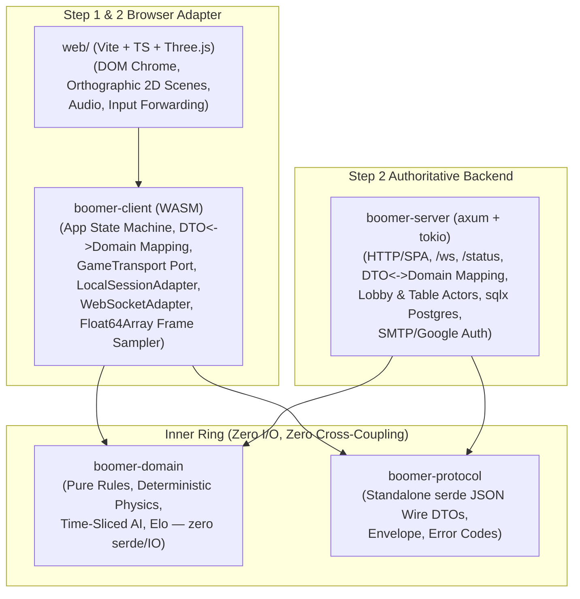
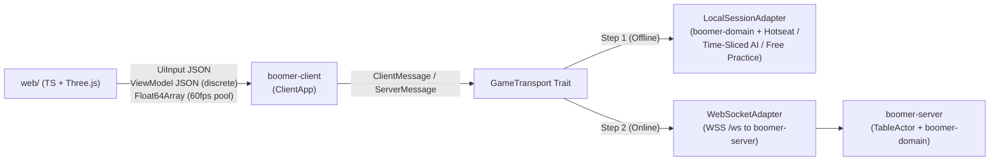

# Boomergames — Implementation Plan

*Engineering roadmap derived from [incubation/plan.md](./incubation/plan.md) and [incubation/turn_based_multiplayer_game_platform_requirements.md](./incubation/turn_based_multiplayer_game_platform_requirements.md).*

## 1. Goals & Guiding Principles

Build **Boomergames**—a completely free, browser-based classic games platform starting with **Checkers (English Draughts)** and **8-Ball Pool**—guided by four engineering pillars:

1. **Rust Everywhere (Single Source of Truth):** Game rules, deterministic physics, AI bots, Elo ratings, protocol definitions, and client state machine all live in Rust. Native (`x86_64`) and browser (`wasm32-unknown-unknown`) run the exact same code.
2. **Strict `clippy::pedantic` & Determinism Everywhere:** Workspace-wide lint enforcement (`clippy::pedantic = "deny"`, `unsafe_code = "forbid"`, no `unwrap`/`expect`/`panic`/`indexing_slicing` in production code, plus `clippy.toml` `disallowed-methods` forbidding non-`libm` float intrinsics), checked on both native and WASM targets with `-D warnings`.
3. **Clean Architecture (Ports & Adapters):** Dependencies point strictly inward. `boomer-domain` is 100% pure (zero I/O, zero `serde`, zero `wasm-bindgen`), `boomer-protocol` is 100% standalone wire DTOs, and a `GameTransport` port trait decouples the client state machine from delivery (`LocalSessionAdapter` in Step 1, `WebSocketAdapter` in Step 2).
4. **Two-Step Delivery:**
   - **Step 1 (Milestones 0–3):** Offline HTML/WASM single-player client (Hotseat, 3-level Computer AI, plus Free Practice mode for Pool) for Checkers and 8-Ball Pool—**no server required**.
   - **Step 2 (Milestones 4–7):** Authoritative single-binary Rust (`axum` + `tokio`) backend with acyclic actor-based lobbies/tables, PostgreSQL (`sqlx`), passwordless auth, ratings, high scores, moderation, and GCP deployment.
5. **Browser-First, Mobile/Tablet-Ready UX:** Desktop web browsers are the primary target, while every lobby, chat, table, and game view is built cleanly for **tablets and smartphones** as well (generous ≥44 px touch targets, responsive drawers/tabs for roster & chat on narrow screens, portrait Checkers & landscape-friendly Pool with slingshot touch play, safe-area insets, and PWA-ready viewport).

---

## 2. Architecture Overview

### 2.1 Clean Architecture Dependency Graph

`boomer-domain` and `boomer-protocol` are completely decoupled from each other. Adapters (`boomer-client` and `boomer-server`) own the `From`/`TryFrom` mapping between wire DTOs and domain entities.



### 2.2 Step 1 → Step 2 Transport Seam & JS↔WASM Bridge

- **Discrete state changes** flow as JSON `ViewModel` updates only when state actually changes.
- **60 fps Pool animation** (`pool_frame(t_ms)`) returns a flat `Float64Array` (fixed 16-ball stride `[id, x, y, flags]` × 16) to avoid per-frame JSON serialization and GC churn.



### 2.3 Target Repository Layout

```text
Boomergames/
├── Cargo.toml                     # Workspace root + [workspace.lints]
├── clippy.toml                    # disallowed-methods for deterministic f64/libm discipline
├── rust-toolchain.toml            # Pinned stable Rust + wasm32-unknown-unknown + clippy/rustfmt
├── Makefile                       # Single-command check, test, wasm, determinism, dev, build
├── IMPLEMENTATION_PLAN.md         # This document
├── incubation/                    # Archived product specs, URD, historical reference screenshots
├── crates/
│   ├── boomer-domain/             # Pure domain logic: zero IO, zero serde, zero wasm-bindgen
│   │   └── src/
│   │       ├── lib.rs
│   │       ├── math.rs            # Deterministic f64 + libm wrappers + -0.0 canonicalization
│   │       ├── checkers/          # Bitboard engine, rules, notation, time-sliced alpha-beta AI
│   │       ├── pool/              # Swept-CCD physics sim, WPA 8-ball rules, aim raycaster, time-sliced AI
│   │       └── rating.rs          # Elo calculator & provisional/anti-farming rules
│   ├── boomer-protocol/           # Standalone serde wire protocol (C->S and S->C enums + DTOs)
│   │   └── src/
│   │       ├── lib.rs
│   │       ├── envelope.rs        # #[serde(tag = "t", content = "d")]
│   │       ├── checkers.rs
│   │       ├── pool.rs
│   │       └── lobby.rs           # Table/Lobby/Auth/Profile/Highscore messages
│   ├── boomer-client/             # WASM crate: client state machine + transport adapters
│   │   └── src/
│   │       ├── lib.rs             # Thin wasm-bindgen API surface
│   │       ├── app.rs             # Client state machine -> ViewModel projection
│   │       ├── mapping.rs         # Explicit From/TryFrom between boomer-protocol & boomer-domain
│   │       ├── ports.rs           # GameTransport, ClockPort, RandomPort traits
│   │       ├── local_adapter.rs   # Step 1 offline session (Hotseat, Time-Sliced AI, Free Practice)
│   │       ├── ws_adapter.rs      # Step 2 WebSocket adapter
│   │       └── animation.rs       # Pool shot timeline buffer + Float64Array pool_frame(t_ms)
│   └── boomer-server/             # Step 2: axum binary (actors, sqlx, auth, SPA, /status)
│       └── src/
│           ├── main.rs
│           ├── config.rs
│           ├── mapping.rs         # Explicit From/TryFrom between boomer-protocol & boomer-domain
│           ├── ports/             # UserRepo, MatchRepo, MailSender, TokenVerifier traits
│           ├── actors/            # Acyclic LobbyActor, TableActor, BotWorkerPool
│           └── adapters/          # axum HTTP/WS, sqlx Postgres, lettre SMTP, Google OIDC
├── migrations/                    # Step 2: sqlx PostgreSQL migrations (4-table schema)
└── web/                           # Vite + TypeScript + Three.js UI shell
    ├── package.json
    ├── vite.config.ts
    ├── index.html
    └── src/
        ├── main.ts
        ├── wasm_bridge.ts         # Thin wrapper calling boomer-client WASM
        ├── i18n/                  # EN + DE string tables
        ├── audio/                 # Procedural/license-free era-appropriate sound effects
        ├── ui/                    # Accessible DOM chrome (header, menus, controls, HUD)
        └── render/
            ├── renderer.ts        # Scene interface
            ├── checkers_scene.ts  # Three.js orthographic 2D checkers board
            └── pool_scene.ts      # Three.js orthographic 2D classic pool table
```

---

## 3. Workspace Lint & Determinism Policy

Every crate inherits `[workspace.lints]` via `[lints] workspace = true`.

```toml
# Root Cargo.toml excerpt
[workspace]
resolver = "3"
members = [
    "crates/boomer-domain",
    "crates/boomer-protocol",
    "crates/boomer-client",
    # "crates/boomer-server", # Added in Step 2 (Milestone 4)
]

[workspace.package]
edition = "2024"
license = "MIT OR Apache-2.0"
rust-version = "1.88"

[workspace.lints.rust]
unsafe_code = "forbid"
missing_docs = "warn"
unreachable_pub = "warn"

[workspace.lints.clippy]
pedantic = { level = "deny", priority = -1 }
unwrap_used = "deny"
expect_used = "deny"
panic = "deny"
todo = "deny"
unimplemented = "deny"
dbg_macro = "deny"
print_stdout = "deny"
print_stderr = "deny"
indexing_slicing = "deny"
```

```toml
# clippy.toml — compile-time determinism guardrails
disallowed-methods = [
    { path = "f64::sqrt", reason = "Use boomer_domain::math::sqrt (libm) for native/WASM bit determinism" },
    { path = "f64::sin", reason = "Use boomer_domain::math::sin (libm) for native/WASM bit determinism" },
    { path = "f64::cos", reason = "Use boomer_domain::math::cos (libm) for native/WASM bit determinism" },
    { path = "f64::tan", reason = "Use boomer_domain::math::tan (libm) for native/WASM bit determinism" },
    { path = "f64::atan2", reason = "Use boomer_domain::math::atan2 (libm) for native/WASM bit determinism" },
    { path = "f64::hypot", reason = "Use boomer_domain::math::hypot (libm) for native/WASM bit determinism" },
    { path = "f64::powf", reason = "Use boomer_domain::math::pow (libm) for native/WASM bit determinism" },
    { path = "f64::powi", reason = "Use explicit multiplication or boomer_domain::math::pow for determinism" },
    { path = "f64::mul_add", reason = "Avoid target-dependent FMA instructions; use separate multiply and add" },
]
```

- **Test Relaxation:** Crate roots opt into test ergonomics via `#![cfg_attr(test, allow(clippy::unwrap_used, clippy::expect_used, clippy::panic, clippy::indexing_slicing))]`.
- **Justified Exceptions:** Any rare exception (e.g., `wasm-bindgen` bindings or deliberate numeric casts in physics) must use `#[expect(clippy::..., reason = "...")]` so stale suppressions fail compilation.
- **Pure Production Dependencies:** `wasm-bindgen-test` is declared strictly under `[target.'cfg(target_arch = "wasm32")'.dev-dependencies]` in `boomer-domain`, keeping its production graph 100% pure.

---

## 4. Step 1 — Offline HTML/WASM Single-Player (No Server Required)

### Milestone 0 — Workspace Foundation, Strict Lints & WASM Vertical Slice

**Goal:** Stand up a zero-warning Rust workspace and Vite/TypeScript/Three.js frontend wired to `boomer-client` WASM before implementing game rules.

- [x] **0.1 Root Scaffolding:** Create `Cargo.toml` with `[workspace.lints]`, `clippy.toml` (`disallowed-methods`), `rust-toolchain.toml` (stable + `wasm32-unknown-unknown` + `clippy` + `rustfmt`), `.gitignore`, and `Makefile` (`check`, `test`, `wasm`, `determinism`, `dev`, `build`).
- [x] **0.2 Independent Inner Crates:**
  - `crates/boomer-domain`: Core pure types (`GameKind`, `Seat`, `BotLevel`, `LocalMode { Hotseat, VsBot(BotLevel), FreePractice }`) and `math.rs` (`libm`-backed deterministic `f64` helpers + `canonical_zero(v)` normalizing `-0.0` to `+0.0`).
  - `crates/boomer-protocol`: Standalone wire JSON envelope (`#[serde(tag = "t", content = "d")]`), `ClientMessage`, `ServerMessage`, `ErrorCode` with zero dependency on `boomer-domain`.
- [x] **0.3 Client Port, Mapper & WASM Bridge:**
  - `crates/boomer-client/src/ports.rs`: Define `GameTransport` (`send`, `poll_messages`, `tick`), `ClockPort`, and `RandomPort`.
  - `crates/boomer-client/src/mapping.rs`: Explicit `From`/`TryFrom` conversions between `boomer-protocol` and `boomer-domain`.
  - `crates/boomer-client/src/lib.rs`: Expose thin `#[wasm_bindgen]` `BoomerClient` (`new`, `dispatch_input`, `tick`, `view_model`, and `Float64Array`-returning `pool_frame`).
- [x] **0.4 Vite + TypeScript + Three.js Shell:**
  - Strict TypeScript config, Three.js orthographic 2D canvas setup, classic 2000s Boomergames CSS theme (cream header, teal-grey side panel, plain rectangular buttons, Verdana/Tahoma stack, ≥16px base font, high-contrast CSS variables).
  - Interactive game-picker home screen (Checkers: Hotseat / vs. Easy / Medium / Hard; 8-Ball Pool: Hotseat / vs. Easy / Medium / Hard / Free Practice) driven entirely by WASM `ViewModel`.

**Exit Criteria:**
- `make check` (fmt + native `clippy::pedantic` + WASM `clippy::pedantic`, all `-D warnings`) passes cleanly.
- `make wasm && make build` produce a working standalone static bundle in `web/dist/`.

---

### Milestone 1 — Checkers (English Draughts) End-to-End

**Goal:** Deliver a complete, rule-accurate playable Checkers game (Hotseat + time-sliced 3-level AI) across the full Clean Architecture stack.

- [x] **1.1 Bitboard Engine & Rules (`boomer-domain::checkers`):**
  - 32-square bitboard state (`black_men`, `white_men`, `black_kings`, `white_kings` as `u32`), mapping standard notation `1..=32` (Black on `1..=12` moves first).
  - Diagonal 1-square moves for men (forward) and kings (forward/backward; no flying kings).
  - Mandatory captures and complete recursive multi-jump generation (player chooses capture path; no max-capture rule).
  - Crowning on far row; mid-jump crowning immediately ends the turn.
  - Win detection (no opponent pieces / no legal moves, resign, timeout) and draw detection (Offer Draw, threefold repetition, 40-move rule without capture or man move).
  - Standard algebraic notation (`11-15`, `22x15`, `22x15x8`).
  - Perft tests, edge-case unit tests, and `proptest` invariants.
- [x] **1.2 Time-Sliced Computer Opponent (`boomer-domain::checkers::ai`):**
  - Resumable alpha-beta minimax (`CheckersSearch::step(node_budget)`) with capture quiescence, move ordering, and positional evaluation so Step 1 WASM stays locked at 60 fps (`~6–8 ms` per frame) while Step 2 server runs it to completion in one worker call.
  - **Endgame mop-up heuristic** (Hard): drives lone opponent kings to board edges/corners and minimizes Manhattan king distance to avoid aimless 40-move draws.
  - Seeded deterministic PRNG (`SplitMix64`): `Easy` (depth 2 + controlled error), `Medium` (depth 4 + slight jitter), `Hard` (depth 7 + full evaluation + endgame mop-up).
- [x] **1.3 Protocol & Offline Client (`boomer-protocol`, `boomer-client`):**
  - `CheckersStateDto`, `CheckersActionDto { path }`, `CheckersResultDto { captured, crowned, notation, board }`, `CheckersSettingsDto` (per-move 20/30/60s or per-game 5/10/15m clock).
  - `LocalSessionAdapter` implementing `GameTransport` for Hotseat and vs. Bot (stepping `CheckersSearch` smoothly across `tick(dt_ms)` with a brief natural thinking floor so moves feel readable).
  - Multi-jump step-by-step OR single-click unambiguous destination selection, mandatory-capture filtering, clocks, Offer Draw, Resign, and alternating-color Rematch (no Undo, maintaining strict Step 2 parity).
- [x] **1.4 Classic 2D Board & HUD (`web/`):**
  - Three.js orthographic 2D 8×8 wooden/classic board, red & black flat discs with crisp king crowns, legal destination highlights, mandatory-capture highlight + *"You must capture"* banner, last-move highlight.
  - Optional **toggleable `1–32` dark-square numbers** on the board matching the standard notation move list.
  - Click-to-move and drag-and-drop input.
  - HUD: player panels, turn indicator, clock, captured-piece count, scrollable notation list, **Flip Board** toggle, Resign / Offer Draw / Rematch controls.

**Exit Criteria:**
- Full Checkers matches playable in Hotseat and vs. Easy/Medium/Hard AI in-browser at locked 60 fps with zero server.
- All unit tests, `proptest` invariants, and `make check` pass.

---

### Milestone 2 — 8-Ball Pool End-to-End (Deterministic Swept-CCD Physics + WPA Rules + Time-Sliced AI + Classic 2D UI)

**Goal:** Deliver a complete, bit-deterministic 8-Ball Pool game with authentic 2000s visual feel, full English spin physics, aiming aids, ball-in-hand, 3-level time-sliced AI, and Free Practice mode.

- [x] **2.1 Deterministic 2D Swept-CCD Physics (`boomer-domain::pool::physics`):**
  - Regulation `2.54 × 1.27 m` playing surface (`ball_radius = 0.028575 m`, 6 pockets with rounded jaws, head string at `x = 0.635 m`, foot spot at `x = 1.905 m`).
  - Strictly `f64` + `libm` via `boomer-domain::math` (enforced at compile time by `clippy.toml` `disallowed-methods`) with `-0.0` → `+0.0` canonicalization before state export/hashing.
  - **Solver:** Fixed `1/240 s` friction substeps combined with **analytic Swept Continuous Collision Detection (CCD)** finding the earliest time-of-impact (`t_hit`) across ball-ball, ball-rail, and ball-pocket-jaw contacts (with a deterministic per-substep event cap) so hard 15-ball rack breaks have zero tunneling and crisp symmetry.
  - **Forces & Spin:** Sliding-to-rolling friction transition, top/back spin (`spin_y`: follow/draw), side English (`spin_x`: cushion throw/rebound angle), velocity-dependent cushion restitution, pocket jaw deflection, drop detection, resting threshold, and deterministic max-duration cap.
  - Emits `ShotSimulation` with discrete events (`FirstContact`, `BallHit`, `CushionHit`, `Pot`, `Scratch`), final resting coordinates, and `1/60 s` keyframes.
- [x] **2.2 Strict WPA/BCA 8-Ball Rules & Aiming Aid (`boomer-domain::pool::{rules, aim}`):**
  - 15-ball triangle rack (8-ball center, one solid & one stripe in rear corners, seeded shuffle).
  - **Break rules:** Table stays **open** after the break even if a ball is pocketed; configurable 8-on-break (re-rack vs. win); break scratch → opponent ball-in-hand.
  - **Open table & groups:** Open table lasts until a legal non-break pot assigns Solids (`1..=7`) / Stripes (`9..=15`). **8-ball is never neutral** on an open table (hitting 8-ball first is always a foul). Turn continues on legal own-group pot.
  - **Fouls & ball handling:** Scratch, wrong first ball hit, no ball hit, or no ball reaches a rail after contact (unless a ball is pocketed) → opponent receives **Ball-in-Hand** (anywhere vs. behind head string, configurable) with live overlap/bounds validator. Foul-pocketed object balls stay down; no 3-foul loss rule; no 2D off-table ball jumps.
  - **Win/Loss:** Legally pocket 8-ball after clearing own group (with optional call-pocket setting). Early 8-ball pot or 8-ball potted on a foul loses immediately.
  - **Free Practice mode:** Solo rack table with unlimited consecutive turns and instant re-rack button for testing shots/spin/break physics.
  - **Pure Rust Aiming Raycaster:** `Off` (cue line only), `Basic` (first contact + ghost ball), `Extended` (ghost ball + predicted object-ball path + cue-ball tangent).
- [x] **2.3 Time-Sliced Pool AI (`boomer-domain::pool::ai`):**
  - Resumable candidate-shot evaluator (`PoolSearch::step(rollout_budget)`) testing legal target ball → pocket lines via `physics.rs` (with safety-shot fallback when no clean pot exists), stepped in `~6–8 ms` slices per frame in WASM so the browser UI never stutters.
  - Seeded deterministic angular/power/spin error scaled across `Easy`, `Medium`, and `Hard`.
- [x] **2.4 Cross-Target Determinism Gate (`tests/pool_determinism.rs`):**
  - 1,000 seeded shots (breaks, heavy follow/draw, side English, banks, jaw rattles) hashed by exact `(id, x.to_bits(), y.to_bits())` and rule events.
  - Verified bit-identical between native (`cargo test`) and WASM (`wasm-pack test --node`).
- [x] **2.5 Protocol, Typed-Array Animation Sampler & Local Adapter (`boomer-protocol`, `boomer-client`):**
  - Protocol DTOs matching `incubation/plan.md` §9.6 (`PoolStateDto`, `PoolActionDto`, `PoolResultDto`, `PoolSettingsDto`).
  - `animation.rs`: Interpolated `pool_frame(t_ms)` returning a flat `Float64Array` (fixed 16-ball stride) + discrete sound cues + exact snap to `result.balls` at rest.
  - Shot clock expiry passes turn with opponent **Ball-in-Hand** (no match forfeit per `incubation/plan.md` D-9).
- [x] **2.6 Classic 2000s 2D Table & Controls (`web/`):**
  - Three.js orthographic 2D table: `#2E8B2E` cloth, `#8B1A1A`/`#6B1010` maroon rails with tan diamonds & pocket caps, 6 black pockets, faint head string, flat numbered solids/stripes (color-blind distinguishable), light-wood cue stick, aiming aid lines.
  - Controls: desktop mouse aim, touch drag + fine-aim slider, right-side vertical power meter with tick marks, left-side cue-ball English spin widget, drag-to-place ball-in-hand with red/green validity indicator, pocketed balls display, top shot clock.

**Exit Criteria:**
- Full 8-Ball Pool playable in Hotseat, vs. Easy/Medium/Hard AI, and Free Practice in-browser at locked 60 fps with zero server.
- 1,000-shot golden determinism test produces bit-identical output on native and WASM (`make determinism`).

---

### Milestone 3 — Step 1 Polish, Audio, Accessibility & Static Delivery

**Goal:** Complete standalone offline quality, i18n, accessibility, and bundle-size budgets.

- [x] **3.1 Era-Appropriate Audio (`web/src/audio/`):** Lightweight Web Audio API effects (cue hit, ball click, cushion thud, pocket drop, checker slide/capture/king chime, 5s shot-clock warning) + mute toggle saved in `localStorage`.
- [x] **3.2 Internationalization (`web/src/i18n/`):** Complete English (`en`) and German (`de`) string tables with runtime switcher.
- [x] **3.3 Accessibility & Responsive Pass:** WCAG 2.2 AA contrast, ≥16px scalable base font, High-Contrast mode toggle, full keyboard menu & Checkers board navigation, responsive layout down to `360px` width, zero cookies (`localStorage` only).
- [x] **3.4 Bundle Budget Audit:** Optimize WASM (`wasm-opt -Oz`, `lto = true`, `opt-level = "z"`) and Vite chunks; confirm initial gzipped payload (HTML/CSS/JS + Three.js + WASM) is `≤ 800 KB`.

**Exit Criteria:**
- Static `web/dist/` build serves cleanly with zero backend, passes all lint/test/determinism/bundle gates, and meets WCAG 2.2 AA + EN/DE requirements.

---

## 5. Step 2 — Authoritative Server Backend & Social Lounge

> Step 2 adds `crates/boomer-server` and `migrations/`. `boomer-domain`, `boomer-protocol`, and the Three.js renderers require zero architectural rewrites—`boomer-client` simply plugs in `WebSocketAdapter` behind `GameTransport`.

### Milestone 4 — `boomer-server` Core, SPA Serving, `/status`, PostgreSQL & Auth

- [x] **4.1 Workspace & Server Skeleton:** Add `crates/boomer-server` to workspace; define server ports (`UserRepo`, `StatsRepo`, `MatchRepo`, `ReportRepo`, `MailSender`, `GoogleTokenVerifier`) and DTO↔Domain mapper (`mapping.rs`).
- [x] **4.2 HTTP Surface (`axum` + `tower-http`):**
  - `GET /` (+ SPA fallback): Immutable 1-year cached hashed assets, `no-cache` `index.html`, `application/wasm`, gzip/brotli, strict CSP (`script-src 'self' 'wasm-unsafe-eval' https://accounts.google.com`).
  - `GET /status`: Cached JSON health endpoint (`status`, `version`, `uptimeS`, `db`, `online`, `tables`, `games`) returning 200 healthy / 503 degraded.
  - `GET /ws`: WebSocket upgrade enforcing `hello` handshake, 4 KB max message size, rate limits (1 msg/s chat, 10 msg/s other), and 20s ping/pong liveness.
- [x] **4.3 PostgreSQL Schema (`migrations/0001_initial.sql` & `sqlx`):**
  - Implement exact 4-table schema from `incubation/plan.md` §9.5 (`users`, `player_stats`, `matches`, `reports`) with `sqlx` runtime queries + automatic embedded migration execution and an in-memory adapter for zero-setup dev/testing.
- [x] **4.4 Passwordless Auth & Client WS Adapter:**
  - Guests (`Guest_XXXX`) with reconnectable guest token (in-memory only, no DB row).
  - Stateless signed session tokens (`user_id` + `session_version`) stored in `localStorage`.
  - Email magic links (`/#login=<token>`, 15-min TTL) via `lettre` over SMTP port 587.
  - Google Identity Services ID token verification (`auth.google`).
  - Unique profanity-filtered display name (30-day change cooldown), avatar picker, GDPR `account.delete`.
  - Implement `crates/boomer-client/src/ws_adapter.rs` (`GameTransport` over `web-sys` WebSocket).

**Exit Criteria:** Two browsers connect to `boomer-server`, authenticate (guest, magic link, or Google), and stay synced over `/ws`.

---

### Milestone 5 — Acyclic Actor-Based Lounges, Matchmaking, Tables & Chat

- [x] **5.1 Actor Concurrency & Backpressure Contract:**
  - **Strict acyclic hierarchy:** `LobbyActor` and `TableActor` never mutually `.await` each other on bounded channels; table-to-lobby state updates are fire-and-forget summaries, while command/reply `oneshot` calls flow strictly downward.
  - **Non-blocking per-client outbound queues:** Actors broadcast via `try_send` into each connection's bounded outbound channel; if a slow client's buffer overflows, that connection is disconnected cleanly rather than stalling the actor.
- [x] **5.2 `LobbyActor` (one `tokio` task per room):**
  - 1–2 initial rooms per game, auto-opening new rooms past ~70% of 100-user capacity.
  - Live User Roster (`Available`, `At Table – Waiting`, `In Game`, `Spectating`), room chat (last 50 lines in memory, 300-char limit, 1 msg/s rate limit, profanity filter), persistent Ignore/Mute list.
  - Table list CRUD (`Public`, `Protected`, `Private`), 30s-expiring Direct Invites, `Play Now` (±200 Elo widening window + 20s human-first wait before bot suggestion).
- [x] **5.3 `TableActor` (one `tokio` task per table, zero shared locks):**
  - Seat 1 (Host), Seat 2, Spectators, isolated Table Chat, Mute Spectators toggle.
  - Host controls (`Boot` with 5-min block, `Invite`, pre-game settings), `Stand Up`, and shareable table links (`/#table=<id>`).
- [x] **5.4 Lounge & Table UI (`web/src/ui/lobby.ts`):**
  - Classic room selector, live roster, chatbox, table list (`Join`/`Watch`/`Full`), Create Table modal, invite toasts, Ignore/Mute controls, with responsive mobile/tablet segmented tabs and ≥44 px touch targets.

**Exit Criteria:** Full multi-user lobby, chat, table creation, invites, and spectating flow works end-to-end without actor deadlocks or slow-client head-of-line blocking.

---

### Milestone 6 — Authoritative Multiplayer Games, House Bots, Elo & High Scores

- [x] **6.1 Authoritative Turn Loop (`TableActor` + `boomer-domain`):**
  - Match lifecycle (`WAITING → READY → IN_PROGRESS → GAME_OVER → Rematch|WAITING`).
  - Strict turn validation (rejects out-of-turn, stale-turn, or spectator moves).
  - Pool authoritative sim on server → broadcast `{ preBalls, shot, state }` → clients replay identical WASM sim (with `serde_json/float_roundtrip` for 0-ULP JSON parity) and snap to `state.balls`.
- [x] **6.2 House Bots & On-Demand Bots:**
  - Always-open 🤖 House Bot tables (3 per room: Easy, Medium, Hard) and host `bot.add`/`bot.remove`.
  - Bot AI runs `boomer-domain` search to completion on a bounded `spawn_blocking` worker pool (`Semaphore`) so actor tasks never stall.
- [x] **6.3 Ratings & High Scores (`boomer-domain::rating` + `sqlx`):**
  - Per-game Elo starting at `1200`, provisional `?` under 10 rated games, tier badges, anti-farming rating decay.
  - Win-count High Score table (human wins only, max 5 wins/day/opponent, min move/shot threshold, tie-broken by `wins_reached_at`, Top 100 + *"Find me"*).
  - Single atomic DB transaction per finished match recording `matches` and upserting `player_stats`; profile shows W/L/D and last 20 matches.

**Exit Criteria:** Rated Checkers and 8-Ball Pool matches with spectators, House Bots, live rating updates, and High Score table work end-to-end with zero Pool desyncs.

---

### Milestone 7 — Resilience, Moderation, Load Testing & GCP Production Deploy

- [x] **7.1 Disconnect & Reconnect:** 45s `PAUSED_DISCONNECT` grace period on socket drop or 2 missed pongs; full `table.snapshot` + game snapshot on reconnect; forfeit (`reason: "disconnect"`) + rating update on expiry; repeat-abandonment cooldown (3 strikes/hour → 5-min cooldown).
- [x] **7.2 Moderation Tools:** User `report` capturing in-memory table/room chat snapshot into `reports`; moderator `mod.mute`, `mod.ban` (with `session_version` bump & live disconnect), and `mod.close_table`.
- [x] **7.3 Graceful Drain & Containerization:**
  - `SIGTERM` drain broadcasts system chat notice (`"Server update in a few minutes — running games will finish"`), refuses new matches, and waits up to 15 min for running matches to complete before shutdown.
  - Multi-stage `Dockerfile` producing a non-root `gcr.io/distroless/cc-debian12:nonroot` image (~30 MB) + `.dockerignore`.
- [x] **7.4 CI/CD, Observability & Launch Validation:**
  - GitHub Actions GCP deploy workflow (`.github/workflows/deploy-gcp.yml`: Workload Identity Federation → Artifact Registry `europe-west3` → Compute Engine VM via IAP) + `deploy/README.md` runbook.
  - `tracing` JSON logs (`BOOMER_LOG_FORMAT=json`) → Cloud Logging + `/status` health check endpoint.
  - Live 200-concurrent-user WebSocket load test + full multi-client integration suite passing in release mode.

**Exit Criteria:** Zero-disruption container deploy passes health checks, E2E suite, and 200-user load test, ready for closed beta invite links.

---

## 6. Verification & Quality Gates (`Makefile`)

Run at every milestone boundary:

```bash
# 1. Formatting & strict pedantic clippy + disallowed-methods (Native + WASM)
make check
#   cargo fmt --all -- --check
#   cargo clippy --workspace --all-targets --all-features -- -D warnings
#   cargo clippy --target wasm32-unknown-unknown -p boomer-domain -p boomer-protocol -p boomer-client -- -D warnings

# 2. Unit & property-based tests
make test
#   cargo test --workspace

# 3. Native vs. WASM Pool determinism gate (Milestone 2+)
make determinism
#   cargo test -p boomer-domain --test pool_determinism
#   wasm-pack test --node crates/boomer-domain --test pool_determinism

# 4. Frontend typecheck, WASM build & gzip bundle check (<= 800 KB)
make wasm && make build
#   wasm-pack build crates/boomer-client --target web --release
#   cd web && npm run typecheck && npm run build
```
